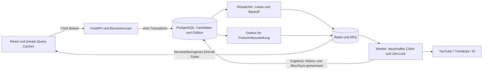

# Architektur und Transaktionsgrenzen

React/TypeScript, FastAPI, PostgreSQL, Redis und ARQ bleiben erhalten. Es gibt
keine neue generische Framework-Schicht und keine automatische Zuordnung von
Bestandsdaten beim Login.

## Backend

`api/videos.py` komponiert Router für Lesen, Import/Export, Tags/Kategorie,
Feldwerte, Löschung und Abspielfortschritt. URLs bleiben erhalten. Die Router
validieren den HTTP-Vertrag und entscheiden über Commit/Rollback.

- `video_creation_service.py`: Einzelanlage und CSV-Orchestrierung.
- `video_import_service.py`: konfliktfeste CSV-Persistenz und Feldwerte. Kein äußerer Commit; letzte gültige CSV-Zeile gewinnt.
- `video_query_service.py`: gemeinsame Sammlungsauswahl für Filter, Sortierung, Count, Seiten und Export; batchweise Hydrierung der aktuellen Seite.
- `video_csv_export_service.py`: vollständiger Export der gleichen Auswahl, ohne Seitengrenze.
- `video_metadata_service.py`: reine YouTube-ID-/Dauer-/Zeitstempelverarbeitung.
- `video_job_service.py`: transaktionsgebundene Verarbeitungs-/Enrichment-Absichten.
- `job_dispatch_service.py`, `workers/outbox_dispatcher.py`: dauerhafte Übergabe, Lease, Backoff und Ziel-Deduplizierung.
- `job_progress_service.py`: gesperrter Elternzähler, persistente Event-ID und Zustellabsicht in einer Transaktion.
- `outbox_operations.py`: ausschließlich lokale Operator-Diagnose, expliziter Retry und begrenzte Retention.

Query-Hydrierung liefert eigene Pydantic-Antwortmodelle. Batchgeladene ORM-
Beziehungen behalten ihre SQLAlchemy-Instrumentierung; Präsentations-Dictionaries
werden nicht in Relationship-Collections geschrieben. Ein äußeres Rollback bleibt
auch nach Leseabfragen funktionsfähig.

Servicefunktionen für Anlage/Import/Query beenden keine äußere Transaktion.
System-Dispatcher haben eigene, explizite Commit-Grenzen. Die finale Worker-
Änderung und die Outbox-Bestätigung werden gemeinsam committet. Provider ohne
Idempotenz können nach Antwort plus Prozessabsturz erneut aufgerufen werden.

## Authentifizierung und Isolation

`core/clerk.py` prüft RS256/JWKS, Issuer, Zeitclaims, Subject, Authorized Party
und gegebenenfalls Audience. `identity_service.py` ordnet die eindeutige Clerk-ID
lokal zu, ohne E-Mail-Merge oder Bestandsdatenübernahme.

HTTP-Datenbanksitzungen erhalten einen obligatorischen Principal.
`access_service.py` erzwingt Eigentumskriterien für ORM-Lese-/Schreibabfragen,
Aliase und Aggregationen; Referenzen werden vor fachlichen Änderungen geprüft.
Dies ist Anwendungsschutz im ORM, keine behauptete PostgreSQL-RLS. Neue
Business-Endpunkte müssen dieselben Dependencies und scoped Sessions verwenden;
ungeprüftes Raw SQL darf diesen Schutz nicht umgehen. Systemworker verwenden
bewusst unscoped Sessions für bereits dauerhaft angenommene Ziele.

Ein WebSocket wird erst nach atomarem Verbrauch eines kurzlebigen Redis-Tickets
angenommen. Der Redis-Kanal ist fest an dessen aktiven Benutzer gebunden. History
wird über dieselbe geschützte HTTP-Sitzung gelesen. WebSub bleibt eine signierte,
begrenzte Ausnahme mit erwarteten Topics und dauerhaftem Replay-Digest.

## Frontend

`SessionBoundary` rendert private Bereiche erst nach geladenem Clerk-Zustand.
Jede Sitzung erhält einen neuen QueryClient. Transportgenerationen und Abbrüche
verwerfen verspätete Antworten, auch nach 401-Erneuerung. Logout/Benutzerwechsel
leeren private Auswahl-, Filter-, Chat-, Import- und Tabellenspeicher.

`hooks/useVideos.ts` ist die Fassade über fokussierte Query-, Mutation-, Transfer-,
Selection- und Cachebausteine in `hooks/videos/`. `videoKeys.ts` definiert die
Video-Schlüssel. Der Server entscheidet Filterzugehörigkeit und Sortierung;
Mutationen invalidieren abgeleitete Ansichten statt Videos ungeprüft anzuhängen.
Generierte Orval-Dateien beziehen ihren Transport aus demselben Axios-Client.

Die Videoseite koordiniert `VideoTable`, `VideoGrid`, `VideoFilterControls`,
`VideoRecoveryStatus`, kontinuierliches Nachladen und Dialoge. Importsteuerung, begrenztes
Statuspolling, seitenübergreifende Duplikatsuche und Feldmutationen haben eigene
Hooks. Ein `WebSocketProvider` verwaltet die einzige Fortschrittsverbindung.
History und Live-Nachrichten teilen Event-IDs und monotone Fortschrittsregeln.

## Große Sammlungen und Betrieb

Offsetseiten: Standard 50, Maximum 100, Gesamtanzahl aus derselben Auswahl und
ID als Tie-Breaker. Tags/Feldwerte werden nur für die aktuelle Seite geladen.
Die UI hält bereits geladene Abschnitte in einem Infinite-Query-Cache und lädt beim Scrollen weitere Abschnitte nach. Filterwechsel starten eine neue Auswahl; alte Requests werden abgebrochen. CSV
bleibt vollständig. Eine seitenübergreifende „Alles auswählen“-Aktion existiert
nicht; eine zukünftige Auswahlaktion muss ihre Reichweite ausdrücklich benennen.

[Messaufbau und Rohdaten](reports/pagination/README.md),
[Queue-Betrieb und Readiness](QUEUE_OPERATIONS.md),
[Auth-Konfiguration](AUTH_SETUP.md) und
[verbindlicher Abnahmestand](reports/codebase-stabilisierung-abnahme.md) unterscheiden
lokale DB-/Redis-/Socket-Nachweise, Simulationen und reale Providerabnahme.
